<p align="center">
  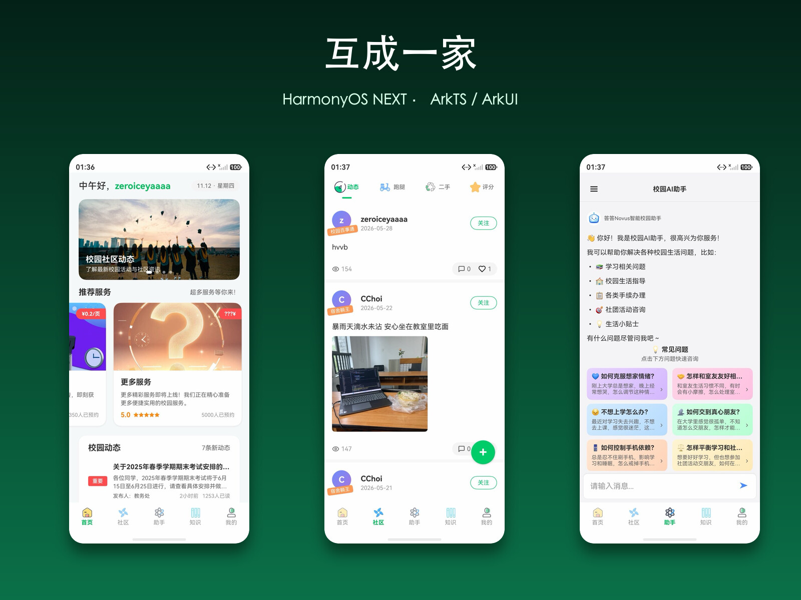
</p>

<h1 align="center">互成一家 · 鸿蒙版</h1>

<p align="center">
  
  
  
  
  
</p>

<p align="center">
  HarmonyOS NEXT（ArkTS / ArkUI）客户端，与「互成一家」微信小程序共用同一套后端。
</p>

- 生产后端：`https://api.hcyj.xyz`
- 本地后端：`http://localhost:3000`

项目从课程期末作业的 HarmonyOS 实现中抽取而来，现已作为独立客户端项目维护，并与微信小程序版逐页对齐。

> **当前状态（2026-11-12）**：30 个页面全部完成，构建通过，CodeLinter 0 error；
> 与小程序的对齐验收已完成，详见 [验收报告](docs/acceptance-report.md)。
> 架构说明、施工清单、验收标准分别见 [AGENTS.md](AGENTS.md)、[docs/parity-plan.md](docs/parity-plan.md)、[docs/acceptance.md](docs/acceptance.md)。

## 界面预览

以下截图均来自 HarmonyOS 模拟器（API 24）真实运行。

| 首页 | 社区 | AI 助手 |
| :---: | :---: | :---: |
|  | 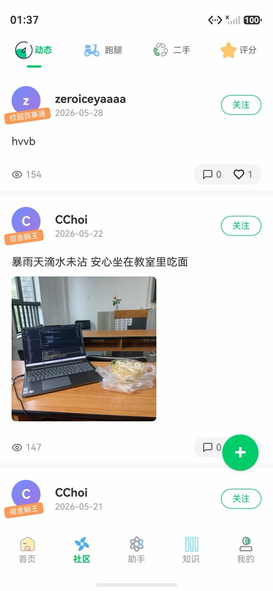 | 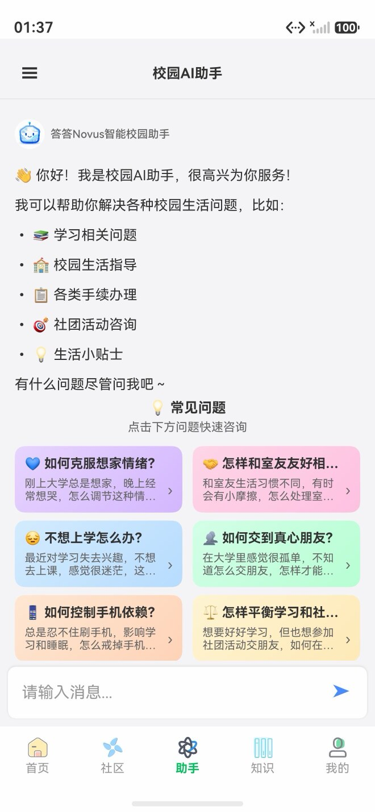 |
| 轮播、服务推荐、校园动态 | 动态流、关注、九宫格图片、发布 | 流式对话、Markdown 渲染、预设问题 |

| 知识库 | 知识详情 | 服务聚合 |
| :---: | :---: | :---: |
| 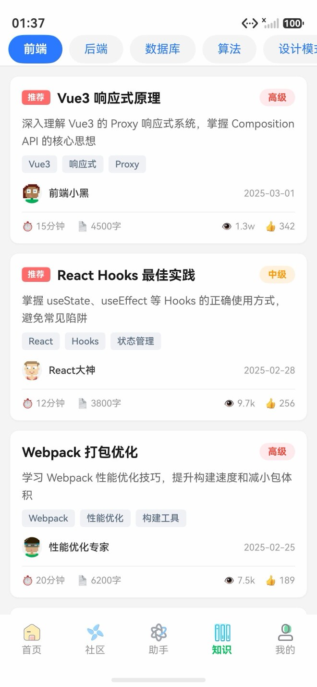 | 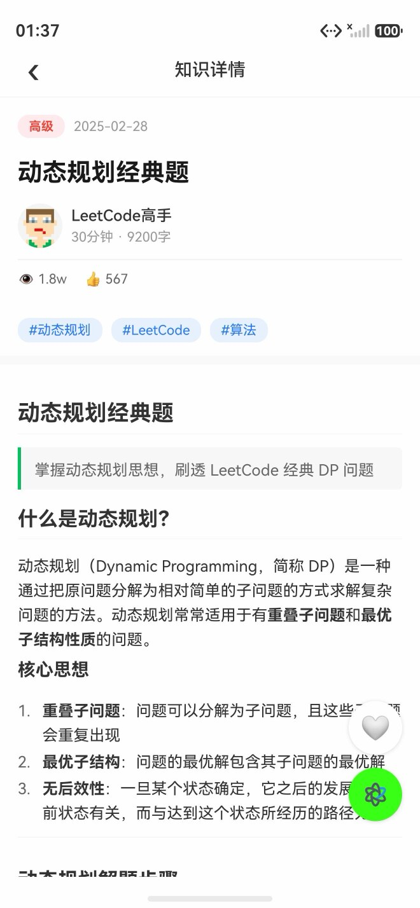 | 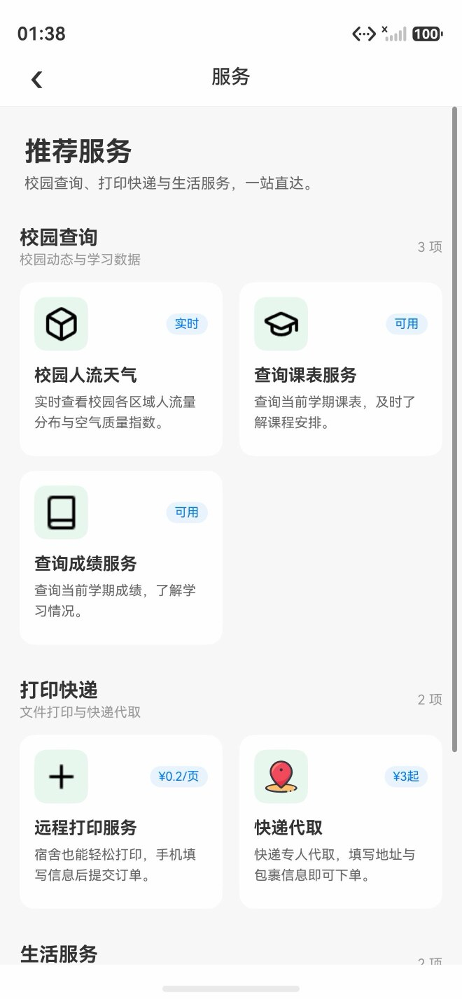 |
| 15 个分类、推荐与难度标签 | 正文渲染、收藏、AI 解读入口 | 校园查询 / 打印快递 / 生活服务 |

| 校园人流 | 任务待办 | 我的 |
| :---: | :---: | :---: |
| 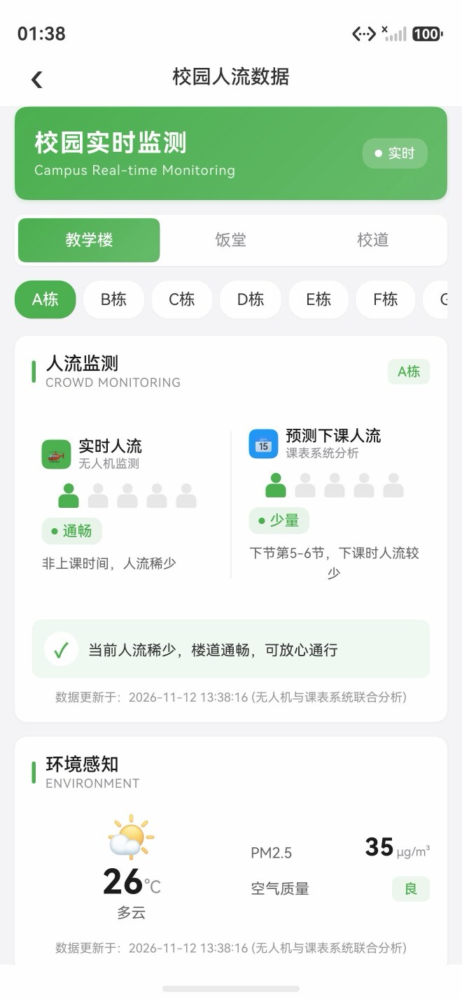 | 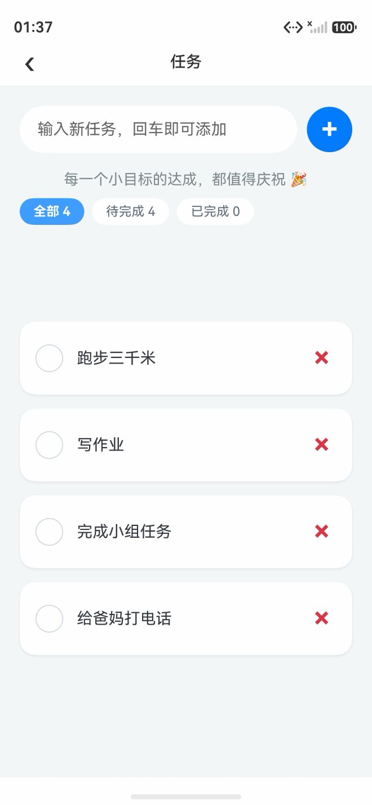 | 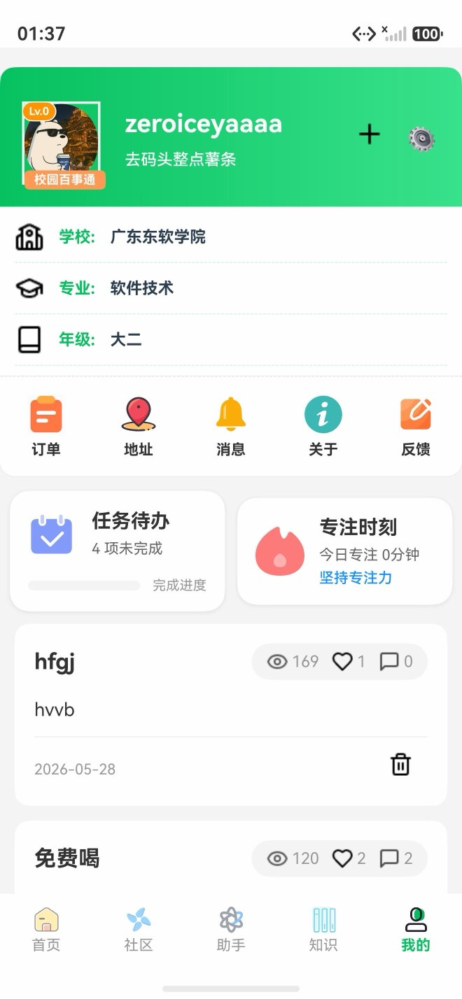 |
| 实时/预测双栏、天气与环境感知 | 筛选计数、完成切换、快捷新增 | 资料、快捷入口、任务与专注摘要 |

| 快递代取 | 设置 | |
| :---: | :---: | :---: |
| 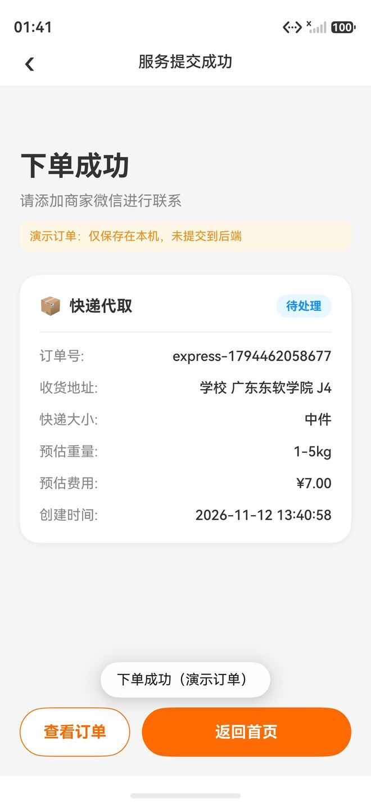 | 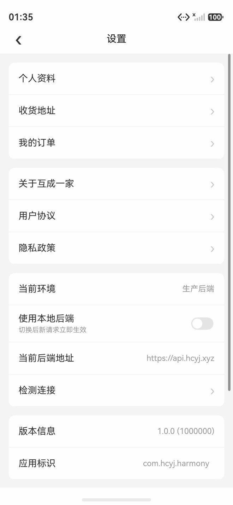 | |
| 地址簿、计价、本机订单与成功页 | 后端环境切换、缓存、协议入口 | |

## 功能

五大 Tab：**首页 / 社区 / 助手 / 知识 / 我的**，共 30 个页面。

| 模块 | 能力 |
| --- | --- |
| 首页 | 轮播、服务推荐、校园动态、推荐岗位；「更多服务」进入服务聚合 |
| 社区 | 动态列表与详情、点赞、一级/二级评论、分页刷新、发布动态（图片上传 + AI 润色） |
| 助手 | DashScope 流式对话、Markdown 渲染、预设问题、历史缓存、重试与复制 |
| 知识 | 15 个分类、推荐标识、文章正文渲染、AI 智能解读 |
| 我的 | 个人资料、我的动态、订单、收货地址、意见反馈、关于、设置 |
| 校园服务 | 人流天气、课表查询、成绩查询、远程打印、快递代取、服务聚合与通用成功页 |
| 通用 | 生产/本地后端切换、Preferences 会话与缓存、401 统一处理、失败降级 |

## 技术栈

- **语言 / UI**：ArkTS + ArkUI 声明式 UI，Stage 模型
- **网络**：`@kit.NetworkKit`，自封装 `HttpClient`（统一信封解包、401 处理、二进制 PUT、SSE 流式）
- **存储**：`@kit.ArkData` Preferences（登录态、资料缓存、后端环境）
- **媒体**：`PhotoViewPicker` / `DocumentViewPicker`、`@kit.CoreFileKit` 文件读取
- **AI**：DashScope 兼容接口，逐字流式输出，支持取消与重试
- **SDK**：compatible `6.0.0(20)`，target `6.1.1(24)`

## 架构

```text
entry/src/main/ets/
├── api/          # ApiConfig、HttpClient、各业务接口
├── components/   # 通用组件（PageHeader、MarkdownView、NetImage…）
├── mock/         # 按域拆分的演示数据
├── models/       # 数据模型
├── pages/        # 30 个页面
├── services/     # AI、上传、分页控制器
├── stores/       # AuthStore、CacheStore
├── theme/        # 颜色 / 字号 / 间距 / 圆角
└── utils/        # 日期、日志、Toast、Mock 门面
```

## 快速开始

1. 安装 **DevEco Studio 6.x**，SDK 安装 API 20 及以上。
2. 复制本地配置模板并填写演示 token 与 DashScope Key：

   ```bash
   cp entry/src/main/ets/api/env.example.ets entry/src/main/ets/api/env.ets
   ```

   `env.ets` 已在 `.gitignore` 中，**不会**进版本库。

3. DevEco Studio 打开本目录（不是 `entry/`），等待 Sync 完成。
4. 签名：`File → Project Structure → Signing Configs`，勾选
   **Automatically generate signature**。证书与密码不要提交。
5. 连接真机或模拟器运行 `entry` 模块。

未填写 `DEMO_TOKEN` 时，网络请求会失败，列表类页面会回退到演示数据，仍可浏览。

### 命令行构建与检查

```bash
./scripts/build.sh      # assembleHap，产物在 entry/build/default/outputs/default/
./scripts/lint.sh       # CodeLinter，要求 0 error
./scripts/preflight.sh  # 构建 + 静态检查 + 仓库卫生预检
```

`DEVECO_HOME` 可覆盖 DevEco Studio 安装路径，默认 `/Applications/DevEco-Studio.app`。

## 本地私密配置

`entry/src/main/ets/api/env.ets`：

```ts
export class ENV {
  // 互成一家后端演示 token（Authorization 裸 token，不要加 Bearer）
  static readonly DEMO_TOKEN: string = '';
  // 阿里云 DashScope API Key，用于「助手」页与 AI 解读
  static readonly DASHSCOPE_API_KEY: string = '';
}
```

AI 功能按真实接口实现，不做假数据：Key 无效时会展示明确错误并提供重试。

## 后端联调

- 默认环境为生产 `https://api.hcyj.xyz`，定义在 `entry/src/main/ets/api/ApiConfig.ets`。
- 切到本地后端：在「我的 → 设置」打开「使用本地后端」，请求立即生效；本地地址为 `http://localhost:3000`。
- 鉴权：后端直接读取 `Authorization` 头，**必须传裸 token**，不能加 `Bearer ` 前缀。
- 接口清单、返回信封、已接入/未接入接口见 [docs/backend-api.md](docs/backend-api.md)。

## 文档

| 文档 | 内容 |
| --- | --- |
| [AGENTS.md](AGENTS.md) | 跨 agent 项目说明、构建命令、协作规则 |
| [docs/parity-plan.md](docs/parity-plan.md) | 页面映射与逐项施工清单 |
| [docs/acceptance.md](docs/acceptance.md) | 验收门槛、页面矩阵与缺陷分级 |
| [docs/acceptance-report.md](docs/acceptance-report.md) | 各轮验收与复验结论 |
| [docs/tech-notes.md](docs/tech-notes.md) | 鸿蒙新特性调研与选型记录 |
| [docs/backend-api.md](docs/backend-api.md) | 后端接口与鉴权说明 |

## 已知限制

- 使用演示 token，不包含微信登录/登录页。
- 微信专属能力（好友分享、订阅消息）未实现；文件/图片选择等以鸿蒙能力替代。
- AI 真实输出需自备有效 DashScope Key；打印真实下单需生产写权限，验收中未执行。
- 课表/成绩真实查询需有效学号密码。

## 与既有项目的关系

| 仓库 | 角色 |
| --- | --- |
| `hcyj-series` | 互成一家全系列：`server` / `admin` / `miniapp` / `web` |
| `who_family_wechat` | 微信小程序客户端（本项目的对齐基准） |
| **本仓库** | HarmonyOS NEXT 客户端，只放鸿蒙端代码 |

## 开发计划

- [ ] 登录闭环：替换演示 token，接入真实登录与 401 重登
- [ ] 关键链路 UI 测试与接口 Mock 测试
- [ ] CI：`hvigorw` 静态检查与构建

## 许可

修改版 MIT，仅限获得书面授权的使用者。详见 [LICENSE](LICENSE)。
